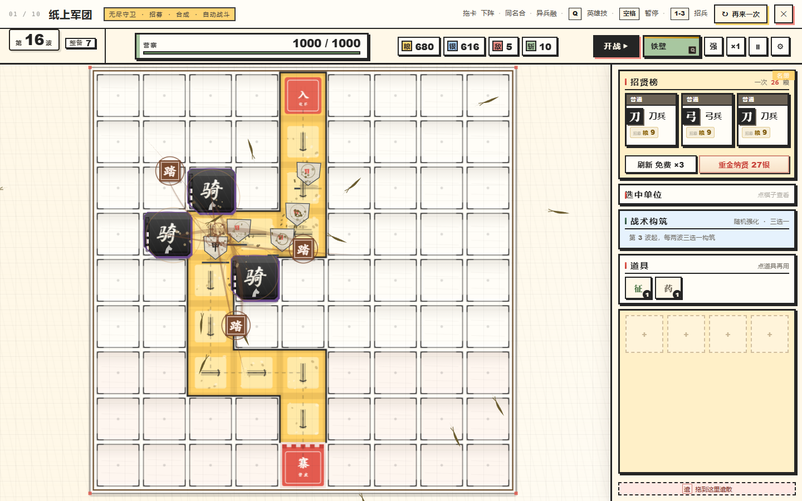

# 纸上军团 · 活字兵阵视觉规范 v1

> 核心理念：文字本身具有生命。汉字是角色主体，笔画是动作与武器，墨迹是攻击与能量，
> 宣纸是场景与材质，朱砂印章是重要状态与强化反馈。五者参与实际游戏表现，不是装饰。

**v1 验收代表图**（骑兵冲锋盖「踏」印 + 毛笔楷「骑」+ 墨迹溅射，2026-11-25）：

## 0. 实现落点（v1 已落地）

- `glyph.ts` — 活字字形层：每兵种/敌人/Boss 独立书风（字体×笔势×墨色×飞白×洇墨），
  离屏缓存；受击/死亡按连通笔画块拆碎片。三套毛笔字体（SIL OFL）见 `site/public/fonts/`。
- `fx.ts` — 特效层：书法斩击 `brushStroke`、墨针 `thrust`、墨晕 `bloom`、朱砂盖印 `stamp`、
  地面墨渍 `stain`、字形解体 `shatter`、定向溅墨 `spatter`；全部定长池。
- `draw.ts` — 棋子主字改用活字渲染；光束改书法横扫；弹道改笔画箭/械矢/朱砂火；
  选中改朱砂四角印框；被控敌人缠绕束缚笔画。
- `battle.ts` — 逐兵种攻击特效与受击/死亡反馈接入（处决「断」、冲锋「踏」、陨火「焚」、
  咒波「缚」、Boss 重击「震」）。
- `game.ts` — 升级「升」/五级「极」/融合「融」盖印，落子墨晕。
- 验收：`scripts/qa-legion-glyph.mjs`，130 敌同场 60fps，0 报错；三字体均加载成功。

## 1. 统一视觉语言

| 元素 | 职责 | 实现 |
| --- | --- | --- |
| 汉字 | 角色主体 | 每兵种独立书法字体 + 墨色处理，离屏缓存（`glyph.ts`） |
| 笔画 | 动作 / 武器 | 攻击特效全部是带笔压的书法笔画（斩 / 刺 / 扫 / 撇捺箭），非几何线条 |
| 墨迹 | 攻击 / 能量 | 命中溅墨、范围晕染、死亡留渍（渐隐墨渍贴花） |
| 宣纸 | 场景 / 材质 | 保留现有纸面棋盘；友军墨牌、敌军纸牌 |
| 朱砂印 | 重要状态 | 重击盖印、升级「升」、五级「极」、融合「融」、处决「断」、精锐「锐」、压制「断」 |

**字体资源**（SIL OFL，`site/public/fonts/`）：
- MaShanZheng.woff2 — 毛笔楷书，厚重果断（刀 / 骑 / 骁 / 焰 / 英雄 / Boss）
- ZhiMangXing.woff2 — 行书，锐利飞动（枪 / 法 / 戟 / 咒师）
- LongCang.woff2 — 行楷，轻逸（弓 / 术）
- 系统楷体 / 仿宋 — 规整几何（工程师 / 多数敌人）

**特效生命周期**：起手（聚墨 0.05–0.1s）→ 释放（行笔 0.06–0.12s）→ 命中（溅墨 / 盖印 0.15s）→ 消散（洇开渐隐 0.2–0.4s）。

## 2. 兵种视觉清单

| 兵种 | 字 | 书法 / 墨色 | 待机 | 攻击特效 | 专属机制反馈 |
| --- | --- | --- | --- | --- | --- |
| 刀兵 | 刀 | 毛笔楷·浓墨·微欹 | 呼吸起伏 | 书法斩击：撇画延伸成刃，笔压收锋，暴击双锋 | 五级处决盖「断」印 |
| 枪兵 | 枪 | 行书·纵向取势·飞白 | 笔锋微颤 | 墨针突刺：笔画凝聚成针，瞬间延伸贯穿 | 五级环刺＝八方针阵 |
| 弓兵 | 弓 | 行楷·淡墨·轻欹 | 弦意轻摆 | 笔画箭：捺画为镞、撇画为羽，墨迹拖尾 | 箭雨＝落点墨晕 + 散箭 |
| 骑兵 | 骑 | 毛笔楷·前倾剪切·重墨 | 蓄势微颠 | 冲锋墨浪：飞白扫痕 + 蹄点墨滴 | 撞击点盖「踏」印 |
| 法师 | 法 | 行书·墨底朱砂渐变 | 墨韵流转 | 火球＝裹墨朱砂弹，落点晕染 | 陨石盖「焚」印 + 焦纸渍 |
| 工程师 | 工 | 仿宋·方正·匀墨 | 稳定少动 | 械矢：短横硬笔 + 机括 notch | 弩塔独立射击、光环墨圈 |
| 术士 | 术 | 行楷·紫墨·环绕符圈 | 符圈缓转 | 咒波晕染 + 束缚笔画缠绕被控敌人 | 定身＝「缚」印 |
| 骁骑 | 骁 | 毛笔楷·剪切·双墨缘 | 同骑 | 贯穿突刺 + 残影 | 撞退墨痕 |
| 戟兵 | 戟 | 行书·宽博 | 呼吸 | 月牙横扫（弧笔）+ 直刺 | 五级环身横扫 |
| 焰弓 | 焰 | 毛笔楷·上墨下朱砂 | 火星微闪 | 火箭＝朱砂笔触 + 焦痕拖尾 | 火雨＝燃烧墨渍区 |
| 英雄 | 锋鸢鹭雪 | 毛笔楷·金墨缘·将印 | 金晕呼吸 | 沿用兵种母型 + 金色笔锋 | 主动技全场盖印 |

**敌人**：旧纸牌 + 灰墨字，按种类区分书风与步态 —— 寇（粗楷·踉跄）、驰（行书剪切·疾颠）、
甲（重墨方楷·沉步）、弩（仿宋·稳）、雷（圆墨·膨胀）、裂（裂字双半错位）、咒（行书·紫墨）、
卫（重楷·朱边）、断（撕纸牌·顶缘缺口）。Boss 用毛笔楷大字 + 墨晕 + 帅旗牌。

## 3. 受击 / 死亡

- 受击：字形纵向压缩（scaleY≈0.86）+ 笔画碎片错位 1–3px + 沿打击方向溅墨 3–6 点。
- 死亡：字形按**连通笔画块**解体飞散（旋转 + 重力 + 渐隐 0.55s）+ 墨点爆散 + 纸屑，
  纸面留一枚渐隐墨渍（≤2.5s，池上限 24）。友军阵亡同样解体。
- 信息清晰：解体只在死亡瞬间发生；存活单位始终整字渲染，血条 / 等级 / 状态印不受动画遮挡。

## 4. 交互反馈

- 选中：朱砂四角印框 + 单位脚下墨圈；射程格淡墨晕染（保留）。
- 放置 / 拖拽落子：落点墨晕涟漪；合 / 融预览为方形朱砂印（保留语义）。
- 升级：盖「升」印 + 金字一闪；五级盖「极」印；融合盖「融」印（替代旧光圈）。
- 压制 / 精锐 / 将：沿用「断」「锐」「将」印语言。

## 5. 性能约定

- 字形按（字 × 书风 × 尺寸档 × 墨色）缓存离屏 canvas；笔画碎片惰性构建（首次受击 / 死亡时）。
- 正常帧每单位 = 1 次 drawImage + 牌形路径；碎片渲染仅在受击 / 死亡窗口。
- 特效定长池：印 12 / 晕 20 / 渍 24 / 刺 24 / 碎片组 16；低画质减半粒子、跳过飞白与墨渍。
- 字体加载完成前用系统楷 fallback，`document.fonts.ready` 后整体重建缓存（代数号）。